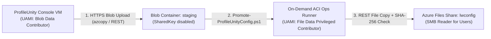

# Running ProfileUnity and FlexApp on Entra-Only Azure Virtual Desktop without Storage Keys

> **Personal project. Research and learning only. Not for production. No warranty.** Not affiliated with the author's employer, Liquidware, or Microsoft.

Traditional deployments of **Liquidware ProfileUnity** and **FlexApp** assume an Active Directory Domain Services (AD DS) environment: the ProfileUnity Management Console runs on a domain-joined server, computer startup scripts (`LwL.ProfileUnity.Client.Startup.exe`) execute as `NT AUTHORITY\SYSTEM` and authenticate to a domain SMB file share via the machine account (`HOSTNAME$`), and administrators sometimes paste a long-lived storage key or Entra client secret directly into the console to automate Azure Files or AVD App Attach.

In a hardened, cloud-native **Azure Virtual Desktop (AVD)** landing zone where session hosts are **Microsoft Entra ID joined** (`AADJoin`) and storage accounts enforce `allowSharedKeyAccess: false`, those traditional assumptions break in three distinct places. This post walks through why they break and the architecture we use across [`avd-liquidware`](https://github.com/nickprignano/avd-liquidware) and [`liquidware-ninja`](../docs/knowledge/profileunity/architecture-and-portability.md) to run ProfileUnity and FlexApp cleanly without enabling storage keys or storing standing Graph/ARM secrets on an appliance VM.

## 1. Why Entra-Only Session Hosts Break Traditional SMB Deployment Paths

When an AVD session host is pure Entra-joined (no hybrid line-of-sight to a domain controller) and mounts an Azure Files Premium FileStorage share configured with **Microsoft Entra Kerberos (`AADKERB`)**:

1. **Interactive user tokens work over SMB:** When an Entra user signs in (or when Cloud Kerberos Trust / Entra Kerberos issues a ticket for synced or cloud identities configured with Azure Files RBAC), the interactive user session can read from `lwconfig` (`Storage File Data SMB Share Reader`) and read/write their own folder in `portability` (`Storage File Data SMB Share Contributor`).
2. **Machine accounts (`SYSTEM`) cannot authenticate to Entra Kerberos SMB shares:** An Entra-only device identity does not receive an SMB Kerberos ticket for Azure Files. Any process running as `NT AUTHORITY\SYSTEM`—including a GPO computer startup script or an Intune system-context Win32 script trying to pull `LwL.ProfileUnity.Client.Startup.exe` over `\\<storage>.file.core.windows.net\lwconfig`—fails with `ERROR_ACCESS_DENIED` or `ERROR_LOGON_FAILURE`.
3. **Standalone appliance VMs cannot mount `AADKERB` shares without storage keys:** A standalone Windows Server VM running the ProfileUnity Management Console (not joined to AD DS) has no Kerberos ticket to write `client.net.zip`, `.ini` files, or `.lic` files directly to `\\<storage>.file.core.windows.net\lwconfig` when `allowSharedKeyAccess: false` is enforced on the storage account.

## 2. Three-Share Separation and Local MSI Bootstrap

First, we split storage concerns across three dedicated shares on the Premium FileStorage account (`stavdlz<env>lwp001`) over Private Endpoint (`10.60.x.x`):

| Share | Purpose | Interactive User RBAC | Quota Floor |
|---|---|---|---|
| `lwconfig` | ProfileUnity `.ini` configurations, `client.net.zip`, license files | `Storage File Data SMB Share Reader` | 100 GiB |
| `portability` | Per-user `%username%` Portability archives (`.lwp` / `.bz2`) | `Storage File Data SMB Share Contributor` | 256 GiB |
| `appattach` | FlexApp `.vhdx` and `.cim` packages staged for AVD App Attach | Host-mounted via AVD Agent / RBAC | 512 GiB |

Because `SYSTEM` cannot read `lwconfig` over SMB at boot on an Entra-only host, **never bootstrap the ProfileUnity Client from an SMB startup path on Entra-only session hosts**. Instead:

- Install the ProfileUnity Client MSI (`LwL.ProfileUnity.Client.msi`) locally during golden image build or via an **Intune Win32 package** deployed to the host pool device group.
- Let the interactive user logon trigger (`LwL.ProfileUnity.Client.Logoff.exe` / user logon hook) read the configuration `.ini` from `\\<storage>.file.core.windows.net\lwconfig` after the user's Entra Kerberos ticket is active.

## 3. Two-Step Config Promotion: Blob `staging` to Azure Files `lwconfig` via On-Demand ACI

If the ProfileUnity Console VM cannot use a storage key and cannot use `AADKERB` over SMB, how do exported configurations get from the console into the `lwconfig` Azure Files share?

We use a **two-step promotion pipeline** backed by User-Assigned Managed Identity (UAMI) and an on-demand **Azure Container Instances (ACI)** ops runner:



1. **Console exports to Blob `staging`:** The ProfileUnity Console VM is assigned a UAMI with `Storage Blob Data Contributor` scoped strictly to the `staging` blob container. ProfileUnity natively supports Azure Blob Storage cloud paths via OAuth/Managed Identity, or an operator script uploads exported `.ini` and `.json` snapshots over HTTPS (port 443) using `AzCopy` with `--login-type=MSI`.
2. **Offline diff & guardrail validation:** Before promoting a configuration from `staging` to `lwconfig`, we validate its plain-text export (`templates/profileunity/sample-config-export.json`) using `Compare-LwProfileUnityConfig` and `Test-LwPortabilityOverlap` from [`LiquidwareNinja.psm1`](../scripts/tools/LiquidwareNinja.psm1):
   ```powershell
   Import-Module ./scripts/tools/LiquidwareNinja.psm1 -Force

   $diff = Compare-LwProfileUnityConfig `
     -ReferenceConfig ./templates/profileunity/sample-config-export.json `
     -DifferenceConfig ./candidate-export.json

   if ($diff.HasChanges) {
     $overlap = Test-LwPortabilityOverlap `
       -PortabilityPath $diff.AddedPortabilityPaths `
       -EnabledModule @('Portability', 'ContextFilter')
     if (-not $overlap.Passed) {
       throw "Promotion blocked: Portability overlap with FSLogix detected."
     }
   }
   ```
3. **On-demand ACI promotion to `lwconfig`:** Because storage accounts lie inside a private VNet with public network access disabled, our operator script (`Promote-ProfileUnityConfig.ps1`) spins up a short-lived subnet-injected ACI container using the ops runner UAMI (`Storage File Data Privileged Contributor` over REST with `--enable-file-backup-request-intent`), copies the validated artifacts from the `staging` blob container into the `lwconfig` file share, verifies the SHA-256 digest (`iniSha256`), and deletes the container group immediately on completion.

## 4. Operator-Registered FlexApp App Attach without Console Client Secrets

Liquidware FlexApp Packaging Console can export packages directly as **AVD App Attach** VHDX or CimFS images. While the ProfileUnity Console includes an integrated wizard to register App Attach packages in Azure, using that wizard requires storing an Entra ID App Registration **client secret** inside the ProfileUnity Console database with `Desktop Virtualization Contributor` permissions across your host pools.

To keep zero standing credentials on the appliance VM:

1. **Package on an isolated Packaging VM:** Capture the application into a VHDX (`AvdAppAttach` delivery mode) on a dedicated, non-production packaging VM whose OS build matches the target session hosts (`osBuildCapturedOn`, e.g., `win11-24h2-ent`).
2. **Generate a validated manifest:** Emit a `liquidware-ninja-flexapp-package/v1` manifest using `New-LwFlexAppManifest`:
   ```powershell
   $manifest = New-LwFlexAppManifest `
     -App 'contoso-reader' `
     -DisplayName 'Contoso Document Reader' `
     -Version '2.4.1' `
     -Format 'VHDX' `
     -DeliveryMode 'AvdAppAttach' `
     -AssignmentPlane 'AvdControlPlane' `
     -SharePath '\\stavdlzdevlwp001.file.core.windows.net\appattach\contoso-reader\2.4.1\contoso-reader.vhdx' `
     -Sha256 '0000000000000000000000000000000000000000000000000000000000000000' `
     -SizeBytes 536870912 `
     -OsBuildCapturedOn 'win11-24h2-ent' `
     -FallbackInstallMethod 'intune-win32' `
     -Ring 'QA'
   ```
3. **Enforce the Single Assignment System Rule:** Before registering the package in AVD, verify with `Get-LwAssignmentConflict` that the application is not simultaneously assigned via ProfileUnity native FlexApp (`ProfileUnityFlexApp`) and AVD App Attach (`AvdAppAttach`). Dual assignment causes duplicate filter driver mounts and start-menu collisions.
4. **Register via `importAppAttachPackageInfo`:** An operator (or OIDC federated GitHub Actions workflow) runs `Register-FlexAppAppAttach.ps1`, invoking the ARM action `POST .../hostPools/{pool}/importAppAttachPackageInfo` while at least one session host in the validation pool is powered on to expand the VHDX metadata, then publishes the package to the QA application group first.

## Key Takeaways

- Keep `allowSharedKeyAccess: false` on your Liquidware storage account; never fall back to storage account keys for `lwconfig`, `portability`, or `appattach`.
- Deliver the ProfileUnity Client MSI locally via image build or Intune Win32 rather than `SYSTEM` SMB startup scripts on Entra-only hosts.
- Promote configuration changes through a hash-verified `staging` blob -> `lwconfig` file share pipeline, and validate Portability rulesets against [`fslogix-portability-guardrails.json`](../templates/profileunity/fslogix-portability-guardrails.json) before promotion.
