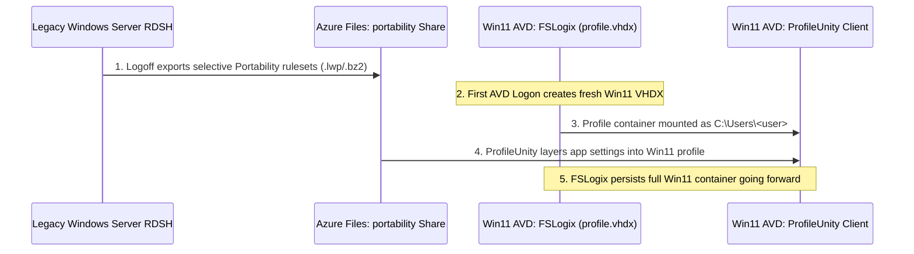

# Crossing the Windows Server RDS to Windows 11 Multi-Session Boundary with ProfileUnity Portability and FSLogix

> **Personal project. Research and learning only. Not for production. No warranty.** Not affiliated with the author's employer, Liquidware, or Microsoft.

One of the most common Azure Virtual Desktop migration scenarios is moving users off legacy **Windows Server 2016, 2019, or 2022 Remote Desktop Session Host (RDSH)** farms (Citrix Virtual Apps and Desktops, Omnissa Horizon RDS, or native Windows RDS) onto **Windows 11 Enterprise multi-session** in AVD.

Even when the legacy RDS farm already uses FSLogix Profile Containers or User Profile Disks (UPDs), **you cannot simply mount a Windows Server OS profile VHDX on Windows 11 Enterprise multi-session**. Crossing the Server-to-Client OS boundary in place introduces `AppX` / `MSIX` package registration corruption, broken Start Menu and taskbar databases (`%LOCALAPPDATA%\TileDataLayer` / `Packages\Microsoft.Windows.StartMenuExperienceHost_*`), and mismatched `NTUSER.DAT` shell keys that manifest as black screens or broken modern shell components.

This post explains how **Liquidware ProfileUnity Portability** bridges that OS boundary cleanly into a brand-new Windows 11 **FSLogix Profile Container**, and why strict path guardrails are required so ProfileUnity and FSLogix never fight over the same folders.

## 1. The Division of Labor: FSLogix Owns the Container, ProfileUnity Bridges the Persona

When FSLogix Profile Containers and Liquidware ProfileUnity run together on Windows 11 Enterprise multi-session, each product must have a single, unambiguous job:

| Layer | Owner | Why |
|---|---|---|
| Primary OS profile VHDX (`%USERPROFILE%`), search index, M365 token cache, OneDrive, Teams, Outlook OST | **FSLogix Profile Container** | Mounted at kernel filter-driver level (`frxdrv.sys` / `frxdrvvt.sys`) before user shell initialization; zero archive unpack overhead for multi-gigabyte caches. |
| Cross-OS persona migration (`HKCU\Software\<Vendor>`, `%APPDATA%\<Vendor>`) & context-aware UEM policies (drive/printer mappings, privilege elevation, app restrictions) | **Liquidware ProfileUnity** | Selective registry and application folder portability rulesets scrub OS-specific shell state and inject only portable user preferences into the fresh Windows 11 profile. |



## 2. Why Unfiltered Portability Rulesets Cause Logon Bloat and File Locks

If an administrator enables a default "save everything in `%APPDATA%` and `%LOCALAPPDATA%`" Portability template on an AVD host pool where FSLogix Profile Containers are already active, two failure modes appear immediately in Stratusphere UX logon breakdowns (`Inspector 10`, `login_duration_s > 30s`):

1. **Double Persistence ("Double Tax" at Logon and Logoff):** FSLogix mounts the VHDX over SMB, and then ProfileUnity spends 20-45 seconds decompressing and copying gigabytes of data from the `portability` SMB share *into* the mounted VHDX over SMB—only to re-compress and upload it all again at logoff.
2. **Exclusive File Locks and Cache Corruption:** Modern apps like New Microsoft Teams (`%LOCALAPPDATA%\Packages\MSTeams_8wekyb3d8bbwe`), OneDrive (`%LOCALAPPDATA%\Microsoft\OneDrive`), Outlook (`%LOCALAPPDATA%\Microsoft\Outlook`), and Chromium browser caches (`%LOCALAPPDATA%\Microsoft\Edge\User Data\Default\Cache`) open exclusive SQLite/IndexedDB handles early in logon. Having Portability overwrite or archive those paths mid-session causes profile corruption or logoff hangs.

## 3. Enforcing the Coexistence Guardrails in Code

We codify the forbidden modules and FSLogix-owned paths in [`templates/profileunity/fslogix-portability-guardrails.json`](../templates/profileunity/fslogix-portability-guardrails.json):

- **Forbidden ProfileUnity Modules when FSLogix is active:** `ProfileDisk`, `VhdProfile` (never stack two full-profile VHDX filter drivers on the same session host).
- **FSLogix-Owned Paths (must never be in Portability rulesets):**
  - `%LOCALAPPDATA%\Microsoft\OneDrive`
  - `%LOCALAPPDATA%\Microsoft\Outlook`
  - `%LOCALAPPDATA%\Microsoft\Teams`
  - `%LOCALAPPDATA%\Packages\MSTeams_8wekyb3d8bbwe`
  - `%LOCALAPPDATA%\Microsoft\Edge\User Data\Default\Cache`
  - `%LOCALAPPDATA%\Google\Chrome\User Data\Default\Cache`
  - `%LOCALAPPDATA%\Temp`
  - `%APPDATA%\Microsoft\Teams`
  - `%USERPROFILE%\OneDrive`

Rather than relying on manual console review, [`LiquidwareNinja.psm1`](../scripts/tools/LiquidwareNinja.psm1) provides two pure functions to enforce these boundaries automatically in CI or pre-promotion scripts:

### Auditing an Existing Ruleset (`Test-LwPortabilityOverlap`)

```powershell
Import-Module ./scripts/tools/LiquidwareNinja.psm1 -Force

$audit = Test-LwPortabilityOverlap `
  -PortabilityPath @(
    '%APPDATA%\Notepad++',
    '%LOCALAPPDATA%\Contoso\ClaimsWorkbench',
    '%LOCALAPPDATA%\Microsoft\Teams\Backgrounds'
  ) `
  -EnabledModule @('Portability', 'ApplicationRestrictions')

# $audit.Passed is $false because '%LOCALAPPDATA%\Microsoft\Teams\Backgrounds'
# is a child of FSLogix-owned '%LOCALAPPDATA%\Microsoft\Teams'.
```

### Generating a Clean Coexistence Ruleset (`Export-LwPortabilityRuleset`)

When building a migration ruleset from a list of candidate application folders discovered on the legacy RDS farm, run `Export-LwPortabilityRuleset` to automatically strip any path that collides with FSLogix-owned directories:

```powershell
$cleanRuleset = Export-LwPortabilityRuleset -IncludePath @(
  '%APPDATA%\Notepad++',
  '%APPDATA%\SAP\Common',
  '%LOCALAPPDATA%\Contoso\ClaimsWorkbench',
  '%LOCALAPPDATA%\Microsoft\Outlook\RoamCache',
  '%LOCALAPPDATA%\Temp\Scratch'
)

# $cleanRuleset.IncludedPaths contains only Notepad++, SAP\Common, and ClaimsWorkbench
# $cleanRuleset.RemovedOverlaps lists Outlook\RoamCache and Temp\Scratch
```

## 4. Cutover Strategy: Hydrate Once or Keep Narrow App-Scoped Rules

In practice, teams choose one of two operational modes after the user's first Windows 11 logon:

1. **One-Time Migration Hydration (Recommended for single-pool AVD estates):** Configure a ProfileUnity Context Filter on the migration Portability rulesets that checks for a marker value in `HKCU\Software\Contoso\Migration\Win11Hydrated = 1`. On first logon to Windows 11, ProfileUnity restores the legacy RDS application settings into the new FSLogix container and writes the marker key. On subsequent Windows 11 logons, FSLogix persists the entire profile natively with zero Portability archive I/O.
2. **Ongoing Cross-Platform Roaming (Hybrid RDS + AVD estates):** If users actively bounce between a Windows Server RDS farm and a Windows 11 AVD pool during a phased multi-month migration, keep only the narrow, non-overlapping application rulesets (`IncludedPaths` from `Export-LwPortabilityRuleset`) active so application preferences roam cleanly between both OS families without touching OS shell or M365 caches.

## Key Takeaways

- Never attach a Windows Server RDS FSLogix/UPD VHDX directly to a Windows 11 Enterprise multi-session host.
- Use ProfileUnity Portability strictly for selective application state (`%APPDATA%\<Vendor>`, `HKCU\Software\<Vendor>`) across OS boundaries, and let FSLogix own the Windows 11 container and all M365/browser caches.
- Gate every ProfileUnity configuration promotion with `Test-LwPortabilityOverlap` and `Export-LwPortabilityRuleset`.
