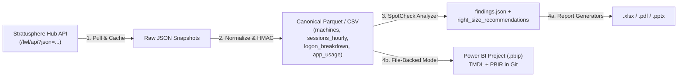

# From Stratusphere UX SpotCheck to Reproducible Deliverables and Git-Backed Power BI Models

> **Personal project. Research and learning only. Not for production. No warranty.** Not affiliated with the author's employer, Liquidware, or Microsoft.

**Liquidware Stratusphere UX** collects remarkably deep endpoint telemetry via the Connector ID (CID) Key (`tntgrd` / `LwL.ConnectorID`): CPU queue depth per core, disk I/O queue length, memory paging, remoting protocol latency, application load times, and broken-out logon phases. Yet two common anti-patterns frequently undermine Stratusphere UX assessments in the field:

1. **Pulling 24-hour average rollups** across a 14-day window, which washes out 9:00 AM logon storms and peak business-hour CPU queueing behind 16 hours of overnight idle zeros.
2. **Connecting Power BI Desktop directly to `/lwl/api` via the Web connector** and saving an opaque binary `.pbix` file containing raw usernames and workstation hostnames.

In [`ux-assess`](https://github.com/nickprignano/ux-assess) and [`liquidware-ninja`](../docs/knowledge/stratusphere/spotcheck-and-sizing.md), we replace ad-hoc API queries and binary `.pbix` files with a deterministic, five-stage assessment pipeline. Here is the engineering rationale behind each stage.

## 1. Why Business-Hour Slicing Beats 24-Hour Averages

Liquidware's **SpotCheck** methodology defines explicit, actionable thresholds for end-user computing health (codified in [`templates/stratusphere/inspector-catalog.json`](../templates/stratusphere/inspector-catalog.json) and queryable via `Get-LwSpotCheckThreshold`):

| Metric | SpotCheck Threshold | Unit | Why 24-Hour Averages Lie |
|---|---|---|---|
| `cpu_used_pct` | `> 80.0` | `%` | An 8-hour shift at 88% CPU followed by 16 hours at 4% averages to **32% CPU**—hiding severe contention. |
| `cpu_queue_avg` | `> 2.0` | `threads/core` | Ready-queue spikes during morning logon storms disappear when averaged with night hours. |
| `memory_used_pct` | `> 85.0` | `%` | Multi-session hosts that reclaim memory after logoff look healthy on a daily mean. |
| `disk_queue_avg` | `> 2.0` | `requests` | Storage IOPS bottlenecks during profile mount (`login_duration_s > 30s`) are diluted across idle intervals. |
| `page_used_mb` | `> 1024.0` | `MB` | Sustained hard-fault paging during peak concurrency gets masked by overnight idle samples. |
| `login_duration_s` | `> 30.0` | `seconds` | Must be evaluated at both mean and **p95** (`p95 > 45s`) to isolate GPO/profile outliers. |

When building `/lwl/api?json=...` queries with `ConvertTo-LwApiUrl` in [`LiquidwareNinja.psm1`](../scripts/tools/LiquidwareNinja.psm1), always pass explicit business-hour bounds (`StartTime = 800`, `EndTime = 1800`) alongside your custom date window:

```powershell
Import-Module ./scripts/tools/LiquidwareNinja.psm1 -Force

$url = ConvertTo-LwApiUrl `
  -HubAddress '10.60.0.4' `
  -Inspector 0 `
  -Basis 'users' `
  -Column @('user_name', 'node_name', 'cpu_used', 'memory_used', 'disk_queue') `
  -StartDate '2026-10-01' `
  -EndDate '2026-10-14' `
  -StartTime 800 `
  -EndTime 1800
```

In the downstream analyzer, we evaluate **both** the full-window distribution and the business-hour (`08:00-18:00`) p50/p95 percentiles so sizing recommendations (`right_size_recommendations`) never under-provision vCPU or RAM for active shifts.

## 2. Why File-Backed PBIP (TMDL + PBIR) Beats the Power BI Web Connector

Liquidware publishes a community Power BI template that uses Power Query (`Web.Contents`) to call the Stratusphere Hub `/lwl/api` endpoint directly. While convenient for a quick live check, pointing Power BI directly at the Hub API has four architectural drawbacks for consulting and migration engagements:

1. **Appliance load and timeouts:** Refreshing multi-inspector tables (Summary `0`, Applications `1`, Connections `2`, Hosts `3`, Machine Inventory `4`, Login Details `10`) directly from Power Query hammers the Hub PostgreSQL database and frequently times out on large estates (>2,500 seats).
2. **No point-in-time reproducibility:** Once the Hub's retention window rolls forward, refreshing the report overwrites your pre-migration baseline.
3. **Binary `.pbix` diffs are impossible in Git:** You cannot review DAX measure changes, table relationships, or SpotCheck threshold updates in a pull request when the model is locked inside a ZIP-compressed binary `.pbix`.
4. **Raw PII lands inside the semantic model:** Usernames (`jdoe@contoso.com`) and endpoint hostnames get embedded in the `.pbix` cache.

Instead, we decouple collection from presentation:



By generating a **Power BI Project (`.pbip`)** with **TMDL** (Tabular Model Definition Language) table/measure definitions and **PBIR** report visuals pointed at local canonical CSV/Parquet files:

- Every DAX measure (`SpotCheck Breach %`, `Logon Duration p95`, `Candidate FlexApp Count`, `Right-Size vCPU Delta`) is plain text in Git.
- Any analyst can open the `.pbip` in Power BI Desktop offline without VPN access to the customer's `10.60.x.x` Stratusphere Hub appliance.

## 3. Deterministic Pseudonymization with Keyed HMAC-SHA256

During an AVD migration assessment, security teams rightfully restrict exporting raw Active Directory usernames (`user_name`), UPNs, and machine names (`node_name`) outside the enclave. However, random anonymization (replacing names with random UUIDs on each run) destroys your ability to compare **Phase 1 (Pre-Migration RDS/Citrix Baseline)** against **Phase 2 (Post-Migration AVD Validation)** for the same cohort of users.

We solve this with **keyed HMAC-SHA256 pseudonymization**:

- A per-engagement secret salt stays inside the customer enclave (never committed to Git).
- Each identifier is normalized (trimmed, lowercased) and hashed via `HMAC-SHA256(salt, value)` into a deterministic token such as `USR-8F3A91C2` or `NODE-4D19B0E7`.
- Because the mapping is deterministic for a given engagement key, `USR-8F3A91C2`'s 42-second logon time on legacy Windows Server RDS can be joined directly against `USR-8F3A91C2`'s 14-second logon time on Windows 11 Enterprise multi-session with FSLogix and ProfileUnity Portability—without ever exposing the user's real identity in `.xlsx`, `.pdf`, `.pptx`, or `.pbip` artifacts.

## 4. Mapping Application Telemetry to FlexApp Packaging Waves

Stratusphere Inspector `1` (`applications`) gives us both the install footprint (`user_share`, `machine_count`), version sprawl (`version_count`), and load performance (`application_load_time_avg`). Rather than guessing which applications belong in the AVD golden image versus **FlexApp App Attach**, we feed those normalized metrics directly into `Test-LwFlexAppCandidate`:

- **> 80% user share:** Bake into the **Base Image** (`BaseImage`) so every session host has the bits hot on the OS disk without filter driver attach overhead.
- **5% - 80% user share (no kernel drivers or boot services):** Package as **FlexApp App Attach** (`FlexAppAppAttach`) for departmental ring delivery.
- **> 3 distinct versions in the field:** Flag for **Version Consolidation First** (`VersionConsolidationFirst`) before packaging.
- **Offline laptop requirement:** Package as **FlexApp One** (`FlexAppOne`) self-contained executable.

## Key Takeaways

- Always slice Stratusphere UX telemetry by active business hours (`08:00-18:00`) and inspect p95 alongside mean values when scoring SpotCheck thresholds.
- Never wire Power BI directly to `/lwl/api` for assessment deliverables; normalize once into canonical tables, pseudonymize with HMAC-SHA256, and commit text-based `.pbip` (TMDL/PBIR) definitions.
